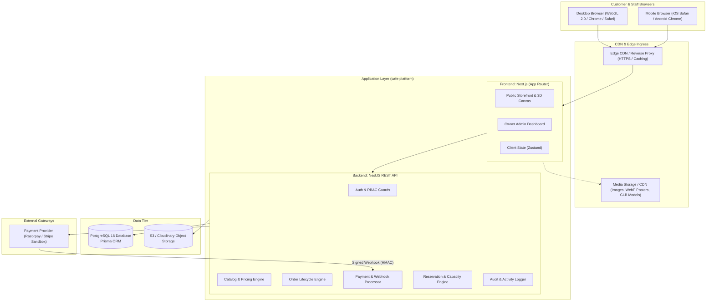

# System Architecture Specification
**Project:** Premium Immersive 3D Cafe Commerce Platform  
**Document:** `docs/architecture.md`  
**Date:** November 22, 2026  
**Status:** Architectural Proposal — Phase 0  

---

## 1. System Topology Overview

The platform uses a modular monorepo architecture designed to enforce clean boundaries between the presentation layer, the business logic engine, and the persistent data tier:



---

## 2. Monorepo Directory Structure

```
cafe-platform/
├── apps/
│   ├── web/                          # Next.js App Router (Storefront + Admin)
│   │   ├── public/
│   │   │   ├── models/               # Optimized runtime GLB files
│   │   │   ├── posters/              # WebP static fallbacks for 3D
│   │   │   └── images/               # Product and editorial imagery
│   │   ├── src/
│   │   │   ├── app/                  # Next.js route groups
│   │   │   │   ├── (storefront)/     # Customer routes: /, /menu, /product, /cart, /checkout, /reservations, /about
│   │   │   │   └── (admin)/          # Admin routes: /admin/dashboard, /admin/menu, /admin/orders, /admin/reservations
│   │   │   ├── components/
│   │   │   │   ├── 3d/               # SceneCanvas, HeroScene, ModelViewer, SceneFallback, BeanParticles
│   │   │   │   ├── commerce/         # ProductCard, OptionSelector, CartDrawer, CheckoutForm
│   │   │   │   ├── layout/           # Header, Navigation, Footer, MobileNav
│   │   │   │   └── ui/               # Design system atoms (Button, Dialog, Badge, Input, Toast)
│   │   │   ├── hooks/                # useCart, useReducedMotion, use3DCapability
│   │   │   └── stores/               # cartStore.ts, adminStore.ts
│   │   ├── tailwind.config.ts
│   │   ├── tsconfig.json
│   │   └── package.json
│   │
│   └── api/                          # NestJS REST API Server
│       ├── src/
│       │   ├── modules/
│       │   │   ├── auth/             # Session/JWT auth, guards, password hashing
│       │   │   ├── users/            # User & Role management
│       │   │   ├── catalog/          # Categories, Products, OptionGroups, Add-ons
│       │   │   ├── orders/           # Pricing engine, Order state machine, Idempotency
│       │   │   ├── payments/         # Payment session creation, Webhook validation
│       │   │   ├── reservations/     # Capacity manager, Slot booking, Overbooking protection
│       │   │   ├── coupons/          # Promotion engine & discount validator
│       │   │   ├── settings/         # Business settings (hours, contact, tax)
│       │   │   ├── media/            # Upload controller & storage adapter
│       │   │   └── audit/            # Operational audit log recorder
│       │   ├── common/               # Filters, interceptors, pipes, decorators
│       │   ├── prisma/               # Prisma service & client provider
│       │   ├── main.ts
│       │   └── app.module.ts
│       ├── prisma/
│       │   ├── schema.prisma         # Database schema
│       │   └── seed.ts               # Sample artisan menu & initial admin account
│       ├── tsconfig.json
│       └── package.json
│
├── packages/
│   └── shared-types/                 # Shared TypeScript DTOs, Enums, API contracts
│       ├── src/
│       │   ├── order.types.ts
│       │   ├── product.types.ts
│       │   ├── reservation.types.ts
│       │   └── api.types.ts
│       └── package.json
│
├── assets-source/                    # Source 3D models (glTF/FBX/OBJ/textures/licenses)
├── docs/                             # Engineering blueprints, audits, inventories, API specs
├── infra/
│   ├── docker/
│   │   ├── docker-compose.yml        # PostgreSQL container + local development stack
│   │   ├── web.Dockerfile
│   │   └── api.Dockerfile
│   └── nginx/                        # Local reverse proxy configuration
├── README.md
├── .gitignore
└── .env.example
```

---

## 3. Database Schema & Data Models (Prisma / PostgreSQL)

Currency is stored in **integer minor units** (e.g., 25000 = ₹250.00 / $250.00) to eliminate floating-point arithmetic errors. All timestamps are recorded in **UTC**.

```prisma
datasource db {
  provider = "postgresql"
  url      = env("DATABASE_URL")
}

generator client {
  provider = "prisma-client-js"
}

enum RoleType {
  ADMIN
  MANAGER
  STAFF
  CUSTOMER
}

enum FulfilmentType {
  PICKUP
  DINE_IN
  DELIVERY
}

enum OrderStatus {
  PENDING_PAYMENT
  PLACED
  ACCEPTED
  PREPARING
  READY
  COMPLETED
  CANCELLED
  PAYMENT_FAILED
}

enum PaymentStatus {
  PENDING
  AUTHORIZED
  CAPTURED
  FAILED
  REFUNDED
}

enum ReservationStatus {
  PENDING_APPROVAL
  CONFIRMED
  SEATED
  COMPLETED
  CANCELLED
  REJECTED
  NO_SHOW
}

model User {
  id            String         @id @default(uuid())
  email         String         @unique
  passwordHash  String?
  name          String
  phone         String?
  role          RoleType       @default(CUSTOMER)
  createdAt     DateTime       @default(now())
  updatedAt     DateTime       @updatedAt
  orders        Order[]
  reservations  Reservation[]
  auditLogs     AuditLog[]
}

model Category {
  id          String      @id @default(uuid())
  name        String
  slug        String      @unique
  description String?
  sortOrder   Int         @default(0)
  isActive    Boolean     @default(true)
  products    Product[]
  createdAt   DateTime    @default(now())
  updatedAt   DateTime    @updatedAt
}

model Product {
  id              String               @id @default(uuid())
  categoryId      String
  category        Category             @relation(fields: [categoryId], references: [id])
  name            String
  slug            String               @unique
  description     String
  basePriceMinor  Int                  // In minor units (paise/cents)
  imageUrl        String
  modelUrl        String?              // Optional path to 3D GLB
  isAvailable     Boolean              @default(true)
  dietaryNotes    String[]             // e.g. ["Vegan", "Gluten-Free", "Nut-Free"]
  optionGroups    ProductOptionGroup[]
  orderItems      OrderItem[]
  sortOrder       Int                  @default(0)
  createdAt       DateTime             @default(now())
  updatedAt       DateTime             @updatedAt

  @@index([categoryId, isActive])
}

model ProductOptionGroup {
  id          String          @id @default(uuid())
  productId   String
  product     Product         @relation(fields: [productId], references: [id], onDelete: Cascade)
  name        String          // e.g. "Milk Choice", "Roast Level", "Syrup"
  minSelect   Int             @default(0)
  maxSelect   Int             @default(1)
  options     ProductOption[]
}

model ProductOption {
  id              String             @id @default(uuid())
  groupId         String
  group           ProductOptionGroup @relation(fields: [groupId], references: [id], onDelete: Cascade)
  name            String             // e.g. "Oat Milk", "Almond Milk", "Extra Shot"
  priceDeltaMinor Int                @default(0)
  isAvailable     Boolean            @default(true)
}

model Order {
  id              String          @id @default(uuid())
  orderNumber     String          @unique // e.g. "CFX-20261122-0042"
  userId          String?
  user            User?           @relation(fields: [userId], references: [id])
  customerName    String
  customerEmail   String
  customerPhone   String
  fulfilmentType  FulfilmentType  @default(PICKUP)
  status          OrderStatus     @default(PENDING_PAYMENT)
  subtotalMinor   Int
  taxMinor        Int             @default(0)
  discountMinor   Int             @default(0)
  deliveryFeeMinor Int            @default(0)
  totalMinor      Int             // Authoritative total
  notes           String?
  cancellationReason String?
  idempotencyKey  String?         @unique
  items           OrderItem[]
  payments        Payment[]
  createdAt       DateTime        @default(now())
  updatedAt       DateTime        @updatedAt

  @@index([status, createdAt])
}

model OrderItem {
  id              String                 @id @default(uuid())
  orderId         String
  order           Order                  @relation(fields: [orderId], references: [id], onDelete: Cascade)
  productId       String
  product         Product                @relation(fields: [productId], references: [id])
  productName     String                 // Snapshot in case product name changes
  quantity        Int
  unitPriceMinor  Int                    // Price snapshot at purchase time
  lineTotalMinor  Int
  selectedOptions OrderItemOptionSnapshot[]
}

model OrderItemOptionSnapshot {
  id              String     @id @default(uuid())
  orderItemId     String
  orderItem       OrderItem  @relation(fields: [orderItemId], references: [id], onDelete: Cascade)
  groupName       String     // e.g. "Milk Choice"
  optionName      String     // e.g. "Oat Milk"
  priceDeltaMinor Int
}

model Payment {
  id                String        @id @default(uuid())
  orderId           String
  order             Order         @relation(fields: [orderId], references: [id], onDelete: Cascade)
  provider          String        // e.g. "RAZORPAY", "STRIPE"
  providerPaymentId String?       @unique
  providerOrderId   String?       // External order reference
  amountMinor       Int
  currency          String        @default("INR")
  status            PaymentStatus @default(PENDING)
  rawWebhookPayload Json?
  verifiedAt        DateTime?
  createdAt         DateTime      @default(now())
  updatedAt         DateTime      @updatedAt
}

model Reservation {
  id            String            @id @default(uuid())
  userId        String?
  user          User?             @relation(fields: [userId], references: [id])
  customerName  String
  customerEmail String
  customerPhone String
  date          DateTime          @db.Date
  timeSlot      String            // e.g. "18:00"
  partySize     Int
  tableNumber   String?
  specialNotes  String?
  status        ReservationStatus @default(PENDING_APPROVAL)
  createdAt     DateTime          @default(now())
  updatedAt     DateTime          @updatedAt

  @@index([date, timeSlot, status])
}

model ReservationCapacity {
  id           String   @id @default(uuid())
  dayOfWeek    Int      // 0 (Sun) to 6 (Sat)
  timeSlot     String   // "08:00", "09:30", etc.
  maxCovers    Int      @default(24) // Maximum seated patrons per slot
  maxParties   Int      @default(8)  // Maximum table reservations
  isActive     Boolean  @default(true)

  @@unique([dayOfWeek, timeSlot])
}

model Coupon {
  id             String    @id @default(uuid())
  code           String    @unique
  discountType   String    // "PERCENTAGE" or "FIXED"
  discountValue  Int       // Percentage (e.g. 15 for 15%) or Minor Units (e.g. 5000 for ₹50.00)
  minSpendMinor  Int       @default(0)
  maxDiscountMinor Int?
  usageLimit     Int?
  usageCount     Int       @default(0)
  expiresAt      DateTime?
  isActive       Boolean   @default(true)
}

model BusinessSettings {
  id              String   @id @default("singleton")
  cafeName        String   @default("Cafex Roastery")
  tagline         String   @default("Artisan Coffee & Warm Gatherings")
  address         String   @default("100 Artisan Way")
  phone           String   @default("+91 98765 43210")
  email           String   @default("hello@cafexroastery.com")
  currency        String   @default("INR")
  currencySymbol  String   @default("₹")
  timezone        String   @default("Asia/Kolkata")
  openingHoursJson Json
  taxPercentage    Decimal @default(5.0)
  deliveryEnabled Boolean  @default(false)
  updatedAt       DateTime @updatedAt
}

model AuditLog {
  id        String   @id @default(uuid())
  userId    String?
  user      User?    @relation(fields: [userId], references: [id])
  action    String   // e.g. "PRODUCT_UPDATE", "ORDER_STATUS_CHANGED", "REFUND_ISSUED"
  entity    String   // e.g. "Product", "Order"
  entityId  String
  metadata  Json?
  ipAddress String?
  createdAt DateTime @default(now())

  @@index([entity, entityId])
}
```

---

## 4. Business Logic Engines

### 4.1 Order Lifecycle State Machine

```
              ┌────────────────────────┐
              │    PENDING_PAYMENT     │
              └───────────┬────────────┘
                          │
       ┌──────────────────┴──────────────────┐
       │ (Signed Webhook: Success)           │ (Timeout / Cancel / Fail)
       ▼                                     ▼
┌──────────────┐                     ┌───────────────┐
│    PLACED    │                     │  CANCELLED /  │
└──────┬───────┘                     │PAYMENT_FAILED │
       │ (Admin Accepts)             └───────────────┘
       ▼
┌──────────────┐
│   ACCEPTED   │
└──────┬───────┘
       │ (Barista Begins Brew)
       ▼
┌──────────────┐
│  PREPARING   │
└──────┬───────┘
       │ (Order Ready on Counter / for Delivery)
       ▼
┌──────────────┐
│    READY     │
└──────┬───────┘
       │ (Handed to Customer)
       ▼
┌──────────────┐
│  COMPLETED   │
└──────────────┘
```

**State Transition Guard Rules:**
- An order can only transition to `PLACED` after a cryptographically verified webhook payload triggers `PaymentStatus.CAPTURED`.
- A customer cannot unilaterally cancel an order once its status has moved to `PREPARING`.
- Admin transitions are recorded with an audit log containing timestamp, actor ID, and optional transition notes.

### 4.2 Server-Authoritative Pricing Calculation

When a customer initiates checkout:
1. Client submits cart payload:
   ```json
   {
     "items": [
       {"productId": "prod-1", "quantity": 2, "optionIds": ["opt-oat-milk"]}
     ],
     "couponCode": "WELCOME10",
     "fulfilmentType": "PICKUP"
   }
   ```
2. The backend pricing engine:
   - Queries database for active prices of `productId` and `optionIds`.
   - Validates that products and selected options are currently `isAvailable = true`.
   - Calculates `subtotalMinor = sum(quantity * (basePrice + sum(options)))`.
   - Evaluates `couponCode` validity, expiry, and minimum order spend.
   - Calculates tax (`subtotal * taxPercentage / 100`) and applicable delivery fees.
   - Generates locked quote with authoritative `totalMinor`.
3. Creates `Order` in `PENDING_PAYMENT` state and requests a payment order ID from Razorpay/Stripe sandbox using `totalMinor`.

---

## 5. Security Architecture

1. **Authentication:** HTTP-only, secure, SameSite cookies carrying signed session tokens or JWTs. Passwords hashed using Argon2 or bcrypt ($cost \ge 12$).
2. **Authorization Guards (RBAC):** Every admin API route is guarded by NestJS `@UseGuards(JwtAuthGuard, RolesGuard)`. Attempts by `CUSTOMER` accounts or unauthenticated clients to access `/api/v1/admin/*` are rejected with HTTP 403 Forbidden.
3. **Webhook Verification:** The payment webhook endpoint (`POST /api/v1/payments/webhook`) extracts the raw binary request body and verifies HMAC signatures using the provider secret before any database mutation occurs.
4. **Idempotency Protection:** Payment webhooks and order creation endpoints verify an `idempotencyKey` in the database to prevent double charging on retry attempts.
5. **Rate Limiting:** Public endpoints (`/api/v1/orders`, `/api/v1/reservations`, `/api/v1/auth/login`) are protected with rate-limiting throttlers (e.g. 10 requests per minute per IP).
6. **Input Validation:** All controller payloads are strictly validated using `class-validator` and `class-transformer` DTO pipes with whitelist filtering.

